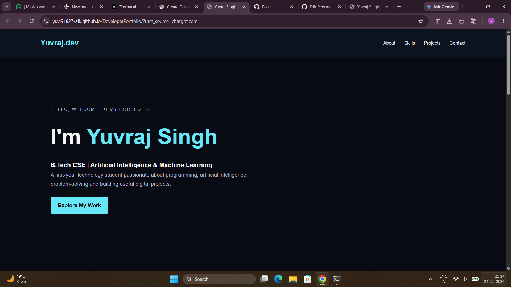
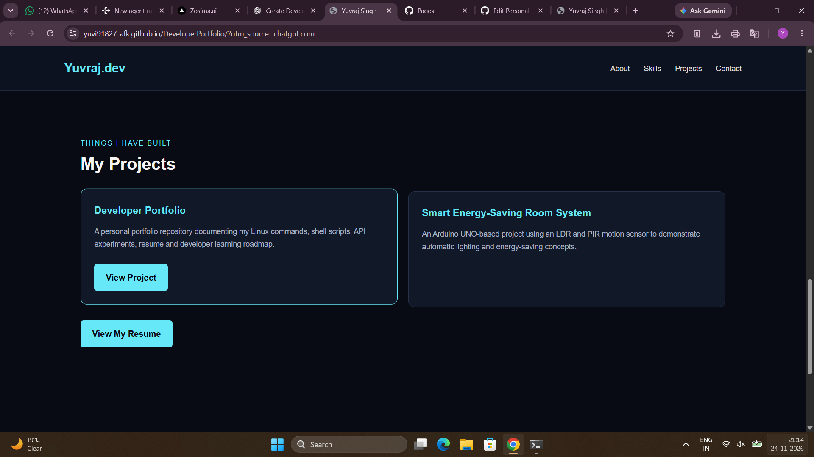
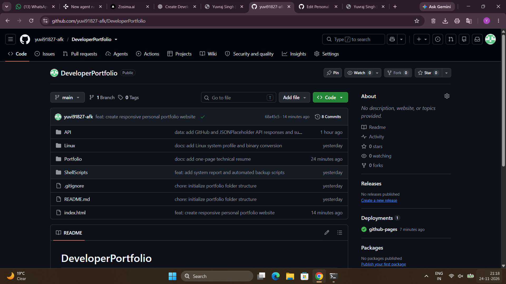

# 🚀 DeveloperPortfolio

Welcome to my Developer Portfolio!

I am **Yuvraj Singh**, a first-year B.Tech Computer Science and Engineering student specializing in Artificial Intelligence and Machine Learning at **K.R. Mangalam University**.

This repository documents my technical learning journey, Linux practicals, shell scripting, API experiments, resume, and career roadmap.

🌐 **Live Portfolio:** https://yuvi91827-afk.github.io/DeveloperPortfolio/

---

## 👨‍💻 Student Information

| Detail | Information |
|---|---|
| Name | Yuvraj Singh |
| Roll Number | 2601730069 |
| Course | B.Tech CSE (AI & ML) |
| Semester | 1st Semester |
| University | K.R. Mangalam University |
| Batch | 2026–2030 |

---

## 📚 Assignment Sections

### Q1. Linux Commands & System Documentation

- Practiced essential Linux commands.
- Explored system processes and resource usage.
- Documented system configuration.
- Studied binary-to-decimal and decimal-to-binary conversions.

**Files:** `Linux/`

### Q2. Shell Scripting & Automation

- Created a system information script.
- Automated system report generation.
- Developed a folder backup script.
- Tested backup functionality and error handling.

**Files:** `ShellScripts/`

### Q3. GitHub Repository & API

- Retrieved GitHub profile information using GitHub REST API.
- Retrieved sample posts using JSONPlaceholder API.
- Saved API responses in JSON format.
- Used `curl` and `jq` for API interaction and data processing.

**Files:** `API/`

### Q4. Developer Portfolio & Career Roadmap

- Created a technical resume.
- Prepared a semester-wise learning roadmap.
- Developed a responsive personal portfolio website.
- Published the website using GitHub Pages.

**Files:** `Portfolio/` and `index.html`

---

## 🛠️ Technologies & Tools

- Linux (Ubuntu on WSL)
- Bash Scripting
- Git & GitHub
- HTML and CSS
- JavaScript Basics
- GitHub REST API
- JSONPlaceholder API
- curl
- jq

---

## 📂 Repository Structure

```text
DeveloperPortfolio/
│
├── Linux/
│   ├── system_profile.md
│   └── commands_output.txt
│
├── ShellScripts/
│   ├── sysinfo.sh
│   ├── backup.sh
│   └── sysinfo_output.txt
│
├── API/
│   ├── github_profile.json
│   ├── sample_posts.json
│   └── api_summary.md
│
├── Portfolio/
│   ├── resume.pdf
│   └── learning_roadmap.md
│
├── Screenshots/
│   ├── website_homepage.png
│   ├── website_projects.png
│   └── github_repository.png
│
├── index.html
├── README.md
└── .gitignore
```

---

## 📸 Project Screenshots

### Portfolio Homepage


### Portfolio Projects


### GitHub Repository


---

## 📄 Resume & Learning Roadmap

- [View Technical Resume](Portfolio/resume.pdf)
- [View Learning Roadmap](Portfolio/learning_roadmap.md)

---

## 🎯 Career Objective

My goal is to develop strong programming and problem-solving skills and build practical projects in Artificial Intelligence and Machine Learning.

I aim to continuously learn new technologies, contribute to projects, and grow as an AI/ML developer.

---

## 🔗 Connect With Me

- **GitHub:** https://github.com/yuvi91827-afk
- **LinkedIn:** https://linkedin.com/in/yuvraj-singh-250263431
- **Portfolio Website:** https://yuvi91827-afk.github.io/DeveloperPortfolio/
- **Email:** yuvi91827@gmail.com

---

⭐ Thank you for visiting my Developer Portfolio!
 DeveloperPortfolio

Welcome to my Developer Portfolio!

I am Yuvraj Singh, a B.Tech Computer Science and Engineering student specializing in Artificial Intelligence and Machine Learning.

## Portfolio Sections

1. Linux - Linux commands and system documentation.
2. ShellScripts - Bash scripting and automation.
3. API - GitHub and REST API interaction.
4. Portfolio - Resume and career roadmap.

## Profiles

- GitHub: https://github.com/yuvi91827-afk
- LinkedIn: https://linkedin.com/in/yuvraj-singh-250263431
